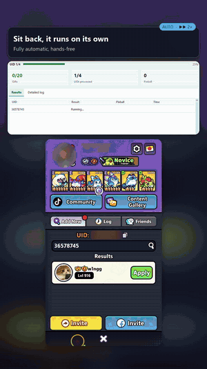
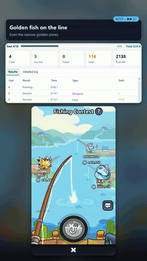
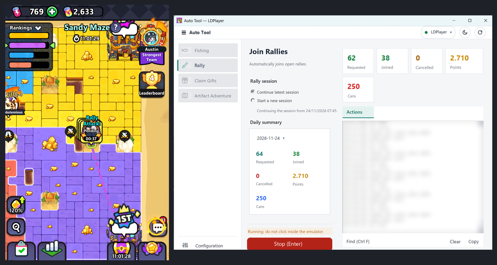

# Clash of Critters — Auto Tool

**Let the game play itself.** Auto Tool claims MVP gifts, fishes, joins rallies and runs Artifact Adventure for you on LDPlayer, while your PC stays free for everything else.

**Để game tự chạy.** Auto Tool tự nhận quà MVP, câu cá, tham gia rally và chơi Artifact Adventure trên LDPlayer, trong khi máy tính của bạn vẫn rảnh tay cho việc khác.

[English](#english) · [Tiếng Việt](#tiếng-việt)

## See it in action

| Claim MVP gifts | Auto fishing |
|:---:|:---:|
|  |  |
| [Watch the full video (45 s)](media/demo-mvp-gifts.mp4) | [Watch the full video (52 s)](media/demo-fishing.mp4) |

Recorded on real runs, sped up for viewing. **Fishing:** 10 casts, 10 catches, 0 misses. **Rally:** 38 rallies joined, 2,710 points and 250 cans in one session.

---

## English

### Features

| Feature | Set it up | Result |
|---|---|---|
| **Claim gifts** | Paste a UID list or choose an ID range | Every MVP Giftbox on the list is claimed. UIDs without a gift are skipped. |
| **Auto fishing** | Choose the number of casts and a multiplier | Casts are fished through to the end, golden fish included, with catches and Gold tallied live. |
| **Join rallies** | Press Start | Open rallies are joined continuously until you stop. Points and cans are totalled per day. |
| **Artifact Adventure** | Set a Torch budget and your rules | Stages, rewards and Zobo encounters are handled within your limits. |

- Runs entirely inside the emulator, so your mouse and keyboard stay free
- Two windows, two emulators, side by side
- Interface available in 11 languages

### What's new

**3.2.2**: The calculator scans fish records faster and updates remaining gold during the scan. You can view it while auto fishing. Only the latest scan log is saved.

**3.2.0**: Fishing adds a **species gold table**. Leave the game on the idle fishing screen or open the fish collection, then press **Scan again** to see each species' weight, current gold, maximum and what is still left. The catch log now records the yellow bonus that slides away, not the silver number beside the fish icon. Rally adds a **Stats** page for one day or every day: joins, entries, cancels, points and cans.

**3.1.0**: Gift claiming picks up where you left off. Stop and press Start again, and your results, gifts and pinball carry on instead of starting over. A new **Add UID** button slots extra UIDs in while it runs; they are handled right after the current one.

**3.0.4**: Sharper fishing. Golden zones, even the narrowest, are hit reliably (100 of 100 casts landed in testing). Any portrait 9:16 LDPlayer resolution is now supported, including 1080×1920 and 900×1600.

**3.0.3**: Redesigned interface with a compact sidebar, clearer summary tiles and a daily Rally summary.

### Requirements

- 64-bit Windows
- LDPlayer with Clash of Critters installed

**One-click setup:** on first launch, press **Configure LDPlayer** and the tool sets the emulator's resolution and ADB for you. No manual LDPlayer settings needed.

### Installation

1. Go to the **Releases** page of this repository.
2. Download `ClashOfCritters-Du-Setup.exe` from the latest release.
3. Run the installer. No administrator rights are required. Launch **Clash of Critters** from your desktop when it finishes.

Updates are delivered through the app. This repository distributes the installer only; source code is not included.

### Activation

On first launch, the **Activation** window shows **two machine lines**. Your key is issued for those lines and works on that computer only.

1. Click **Copy code**.
2. Email the code to either address below, together with the plan you want and your preferred payment method:
   - truong.truongbacat@gmail.com
   - trinhtienquang2002@gmail.com
3. Paste the key you receive into **Key** and click **Continue**.

The tool opens straight away on that computer from then on. Reinstalling Windows or replacing drive `C:` changes the machine code; send the new lines to receive a new key.

### Pricing

All prices are in USD. One key activates one computer.

| Plan | Price | Per month | |
|---|---|---|---|
| Trial, 3 days | $1 | | Try before you buy |
| 1 month | $10 | $10 | |
| 2 months | $15 | $7.50 | Save 25% |
| **3 months** | **$18** | **$6** | ⭐ **Best value, save 40%** |
| Lifetime | $50 | | One-time payment, no expiry |

Need it on another computer? Each additional computer requires its own key.

### Fair-use notice

Auto Tool only interacts with the game inside LDPlayer. Automated play may be detected by the game and can lead to account restrictions. We recommend starting on a secondary account with a small UID list.

---

## Tiếng Việt

### Tính năng

| Chức năng | Bạn chỉ cần | Kết quả |
|---|---|---|
| **Nhận quà** | Dán danh sách UID hoặc chọn dải ID | Nhận toàn bộ hộp quà MVP trong danh sách, UID không có quà tự động bỏ qua. |
| **Tự câu cá** | Chọn số lượt và hệ số | Câu trọn từng lượt, kể cả cá vàng, thống kê số cá và Gold theo thời gian thực. |
| **Tham gia rally** | Bấm Bắt đầu | Liên tục vào các rally đang mở cho đến khi bạn dừng, điểm và lon được cộng theo ngày. |
| **Artifact Adventure** | Đặt số Torch và luật chơi | Tự qua stage, nhận thưởng và xử lý Zobo trong giới hạn bạn đặt. |

- Chạy hoàn toàn trong giả lập, chuột và bàn phím vẫn rảnh
- Hai cửa sổ chạy song song trên hai giả lập
- Giao diện 11 ngôn ngữ

### Có gì mới

**3.2.2** giới thiệu **Công cụ tính** với quét danh sách cá nhanh hơn và cập nhật điểm còn lại ngay trong lúc quét. Có thể mở xem khi đang tự câu. Công cụ chỉ giữ log của lần quét gần nhất.

**3.2.0**: Câu cá có **Bảng điểm vàng cá**. Để game ở màn câu đang rảnh hoặc mở sẵn kho cá, rồi bấm **Quét lại** để xem cân nặng, điểm vàng hiện tại, điểm tối đa và phần còn thu được của từng loài. Cột điểm vàng ghi chữ vàng cộng điểm vừa trượt đi, không còn lấy số bạc cạnh icon cá. Rally có mục **Thống kê** theo một ngày hoặc tất cả ngày: số lần xin, vào được, hủy, điểm và lon.

**3.1.0**: Nhận quà chạy tiếp đúng chỗ đã dừng. Bấm Dừng rồi Bắt đầu lại, kết quả, số quà và pinball vẫn giữ nguyên thay vì chạy lại từ đầu. Nút **Thêm UID** mới cho chen thêm UID khi đang chạy, UID mới được xử lý ngay sau lượt hiện tại.

**3.0.4**: Câu cá chuẩn hơn. Bấm trúng vùng vàng kể cả khi rất hẹp (thử nghiệm 100/100 lượt câu được cá). Hỗ trợ mọi độ phân giải LDPlayer dọc 9:16, gồm cả 1080×1920 và 900×1600.

**3.0.3**: Giao diện mới với thanh bên thu gọn, ô thống kê rõ ràng hơn và tổng hợp Rally theo ngày.

### Yêu cầu

- Windows 64-bit
- LDPlayer đã cài Clash of Critters

**Thiết lập một chạm:** lần đầu mở tool, bấm **Configure LDPlayer**, tool tự đặt độ phân giải và bật ADB cho giả lập. Không cần tự chỉnh gì trong LDPlayer.

### Cài đặt

1. Vào mục **Releases** của repo này.
2. Tải `ClashOfCritters-Du-Setup.exe` ở bản mới nhất.
3. Chạy bộ cài, không cần quyền quản trị. Cài xong, mở **Clash of Critters** từ màn hình Desktop.

Các bản cập nhật được nhận ngay trong ứng dụng. Repo này chỉ phát hành bộ cài, không chứa mã nguồn.

### Kích hoạt

Lần đầu mở tool, hộp **Activation** hiện **hai dòng mã máy**. Key được cấp theo đúng hai dòng này và chỉ dùng trên máy đó.

1. Bấm **Copy code**.
2. Gửi mã qua email tới một trong hai địa chỉ dưới đây, kèm gói muốn mua và hình thức thanh toán:
   - truong.truongbacat@gmail.com
   - trinhtienquang2002@gmail.com
3. Dán key nhận được vào ô **Key** và bấm **Continue**.

Từ lần sau, tool mở thẳng trên máy đó. Nếu cài lại Windows hoặc thay ổ `C:`, mã máy sẽ đổi; gửi lại hai dòng mới để nhận key mới.

### Bảng giá

Giá tính bằng USD. Mỗi key kích hoạt một máy tính.

| Gói | Giá | Mỗi tháng | |
|---|---|---|---|
| Dùng thử 3 ngày | $1 | | Trải nghiệm trước khi mua |
| 1 tháng | $10 | $10 | |
| 2 tháng | $15 | $7,5 | Tiết kiệm 25% |
| **3 tháng** | **$18** | **$6** | ⭐ **Lợi nhất, tiết kiệm 40%** |
| Vĩnh viễn | $50 | | Trả một lần, không hết hạn |

Dùng thêm máy khác thì mỗi máy cần một key riêng.

### Lưu ý khi sử dụng

Auto Tool chỉ thao tác với game bên trong LDPlayer. Game có thể phát hiện thao tác tự động và hạn chế tài khoản. Nên bắt đầu bằng tài khoản phụ với danh sách UID nhỏ.
